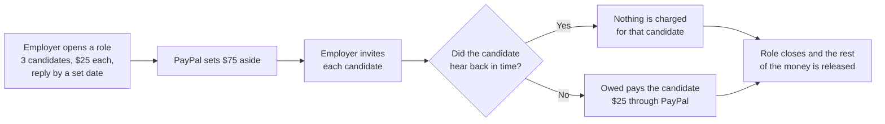
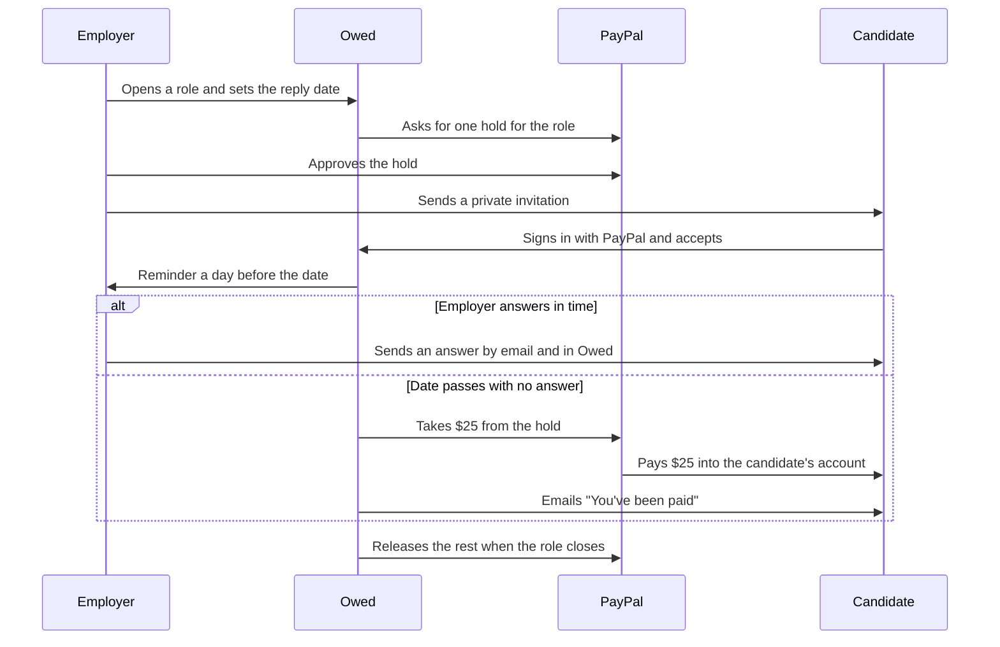

# Owed

Every interviewed candidate hears back by a set date. If they don't, they get paid.

Live demo: [owed-vert-ten.vercel.app](https://owed-vert-ten.vercel.app). It runs on the PayPal sandbox, so all money is test money. Built for the PayPal AI Hackathon.

## The problem

Candidates prepare for an interview, take time off work, sit through the rounds, and then hear nothing. 63% of US job candidates say they were left in the dark after an interview ([Greenhouse 2025 Workforce & Hiring Report](https://www.prnewswire.com/news-releases/only-7-of-candidates-say-the-job-market-favors-them-amidst-challenges-of-ageism-ai-cheating-and-ghosting-302507370.html)). Most employers mean to reply, but nothing happens to them when they forget.

## What Owed does

Owed puts money behind the promise to reply. An employer picks an amount for each candidate they interview, for example $25, and a date by which every candidate will hear back. PayPal sets that money aside. If a candidate hears nothing by the date, Owed sends them their $25 through PayPal. If the employer replies on time, nobody pays anything and the money goes back.

## How it works

1. The employer opens a role and writes the promise as one sentence: "Pay each of 3 candidates for Product Designer $25 if they hear nothing by" a date up to three weeks away.
2. The employer approves one PayPal hold for the whole role, $75 in this example. The money is set aside in their PayPal account. It isn't charged.
3. The employer invites each interviewed candidate. The candidate signs in with PayPal and accepts. Only the person who was invited can accept.
4. Before the date, the employer sends each candidate an answer: moving forward, not moving forward, or still deciding with a new date. The employer can ask the AI to write the first draft.
5. A day before the date, Owed emails the employer about anyone still waiting.
6. If the date passes without an answer, Owed takes that candidate's $25 from the hold and pays it into their PayPal account. Nobody has to press a button.
7. When the role closes, PayPal releases whatever is left of the hold.

Here's what happens over the life of one role:

## What it looks like

These screenshots use test data.

### For employers

The role page reads like a receipt. It shows what's held, who has been invited, who has heard back, and who has been paid.

Writing an answer to a candidate. The AI drafts it, checks the wording, and warns the employer before anything risky goes out.

### For candidates

A candidate sees the employer's promise before they accept it.

If the date passes without an answer, the candidate sees the payment and its PayPal reference.

### Emails

Candidates get the employer's answer as a letter, and a receipt when they've been paid.

| The employer's answer | The payment receipt |
| --- | --- |
|  |  |

## Where PayPal comes in

PayPal handles every step that involves money or identity.

| What happens | PayPal feature |
| --- | --- |
| Employers and candidates sign in | Log in with PayPal |
| The employer sets the money aside | A PayPal hold that's approved once per role |
| Keeping the money set aside for longer | Renewing the hold |
| A candidate wasn't answered in time | Taking that candidate's share from the hold |
| The candidate gets paid | PayPal Payouts into the candidate's account |
| The role closes | Releasing the rest of the hold |

## What the AI does

The AI only works with words. It never decides whether money moves. Holds, payments and releases follow fixed rules.

- It drafts a short, kind answer that states the candidate's status and nothing more. The employer can edit it.
- It checks the final wording and flags anything that could hurt a candidate or cause trouble: reasons for a rejection, feedback, comparisons with other candidates, promises of future roles, or comments about age or other personal traits. The employer has to tick a box to confirm they've read a warning before sending.
- A "still deciding" answer must give the new date, and links or email addresses are refused.
- If the AI isn't available, the employer can still send Owed's standard answer, so a candidate is never left waiting because of it.

In one test, the message "We are not moving forward because we want someone younger with more energy. Maybe a future role will suit you." got three warnings: the reason, the age comment and the promise of a future role.

## Who pays the fees

Today the hold covers only the candidates' amounts, and Owed covers PayPal's fees, so candidates always get the full amount they were promised. In a sandbox test, PayPal charged a $0.52 fee on a $1.00 payment. Next, the employer's hold will include the expected fees too.

## Why an employer would use it

Owed costs an employer nothing if they do what they already promise. In return, they can show candidates that their promise to reply is backed by real money, which matters most where candidate experience affects who applies. Job boards could badge or rank those roles. These are arguments for the product. We haven't tested real employer demand yet.

## Tested with real PayPal sandbox accounts

Everything below ran on the live demo with PayPal sandbox accounts, and Owed's scheduler did every step on its own:

- An employer signed in with PayPal, approved a hold, and later closed the role, which released the hold.
- A candidate accepted an invitation in time, the date passed with no answer, and Owed paid them $1.00 through PayPal. The candidate's sandbox account received it, and both sides saw the PAID stamp with the PayPal reference.
- A two-candidate role went through a reminder, a "still deciding" answer with a new date, and a final answer. Every email arrived exactly once, and the hold was released with nothing charged.

In a separate sandbox check, sending the same payment to PayPal twice was refused the second time, so a retry can't pay anyone twice.

## Built with APIMatic

We built the PayPal connection with APIMatic's Context Plugin for PayPal, and every hold, payment and release goes through APIMatic's generated PayPal SDK.

- The plugin had us write down every PayPal call before coding it, in [`paypal-plan.md`](paypal-plan.md), using the SDK's own map instead of memory.
- The map showed which parts of PayPal the SDK covers and which it doesn't, like Payouts and sign-in, so we connected those directly.
- Its error guide shaped how Owed handles a PayPal request that times out, and its testing guide caught a bug where the SDK misread PayPal's empty reply when a hold was released.

The details are in the [technical notes](docs/technical.md#how-apimatics-context-plugin-shaped-the-integration).

## What's next

- Employers cover PayPal's fees as part of the hold.
- PayPal webhooks, so Owed hears about changes right away.
- A charity fallback for payments a candidate never collects.
- A review for live PayPal.

## For developers

Setup, architecture, the database, the scheduler and every PayPal detail are in the [technical notes](docs/technical.md).

## License

MIT. The APIMatic skills in `.devin/skills/` are MIT licensed by APIMatic.
