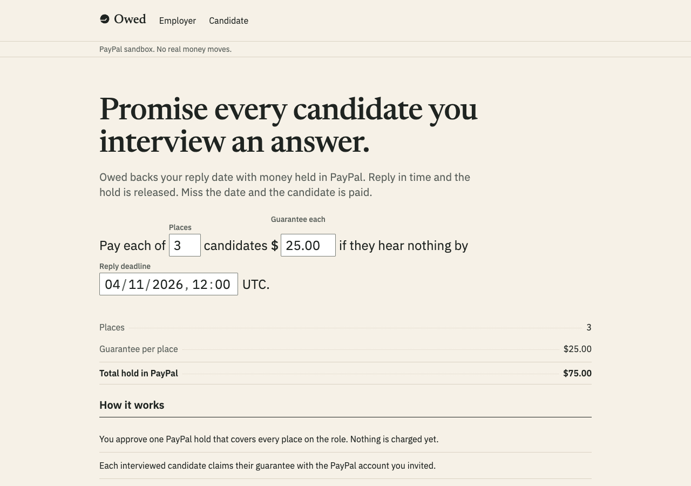
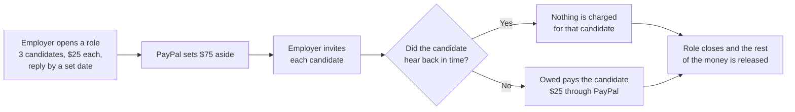
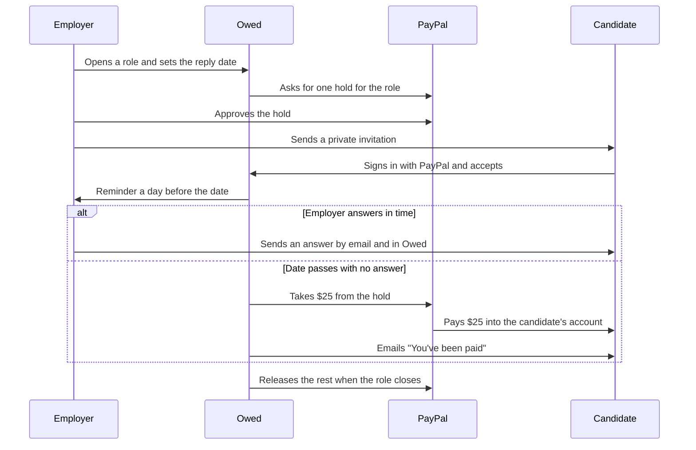
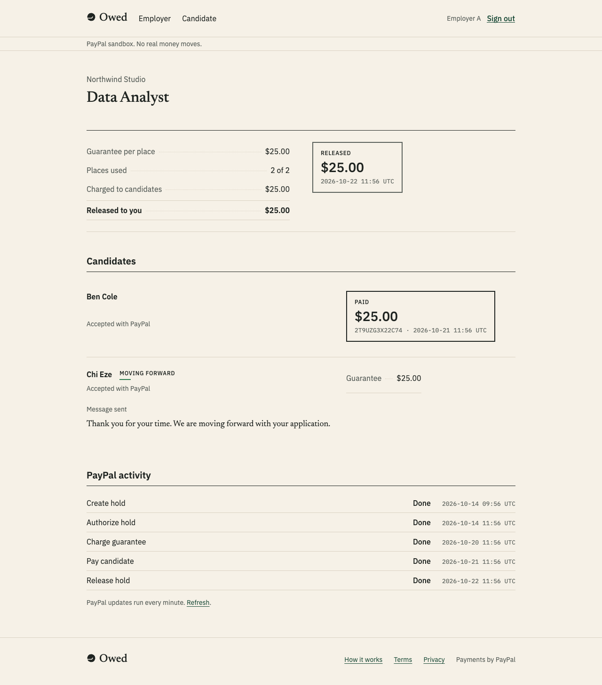
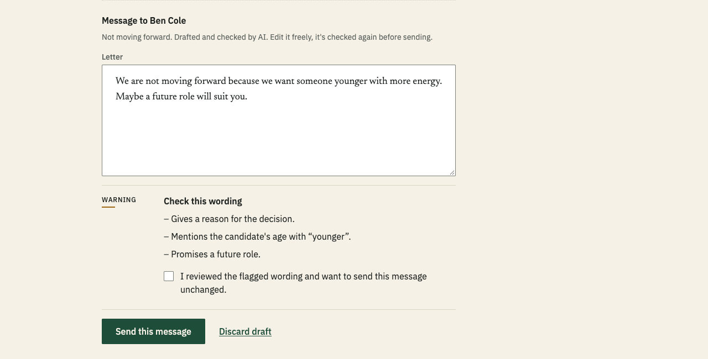
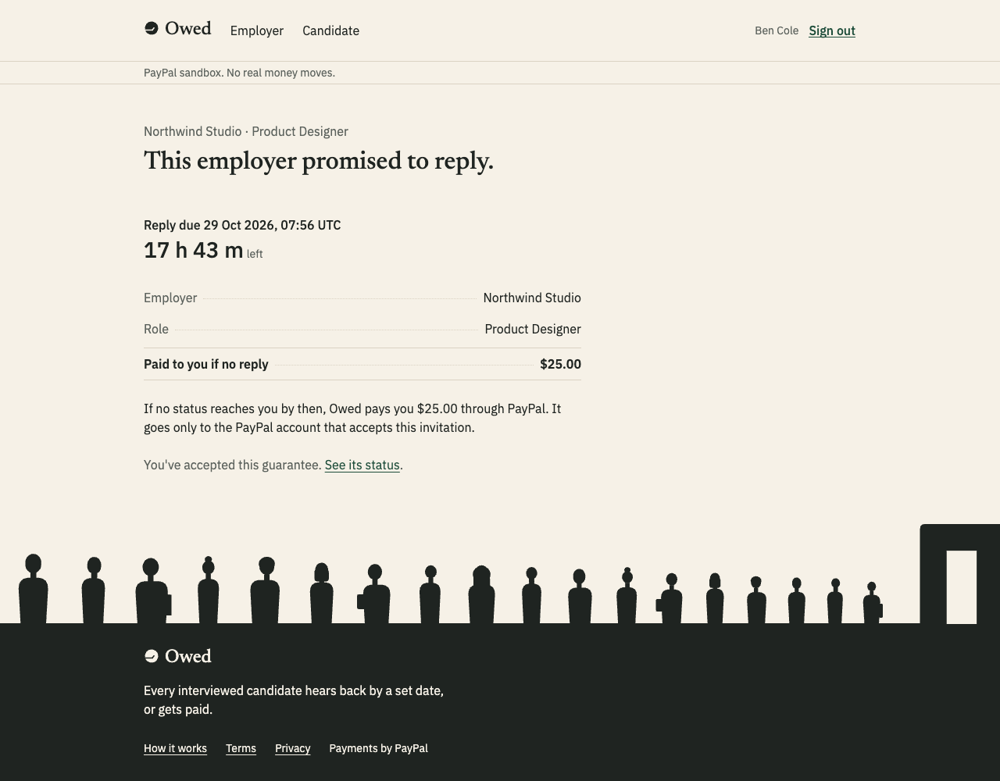
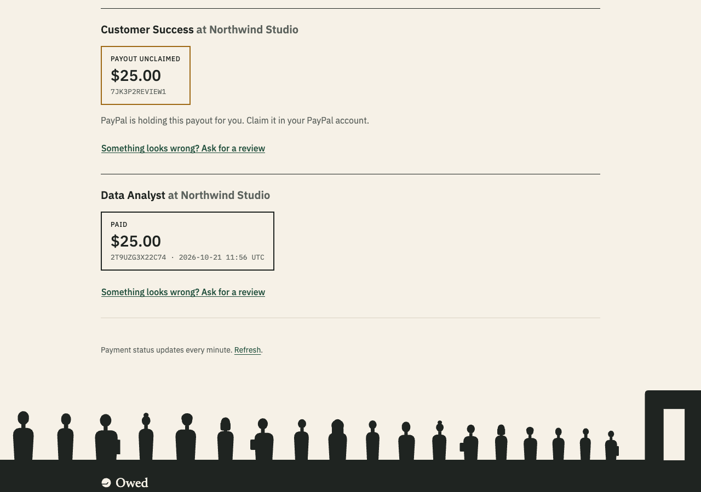
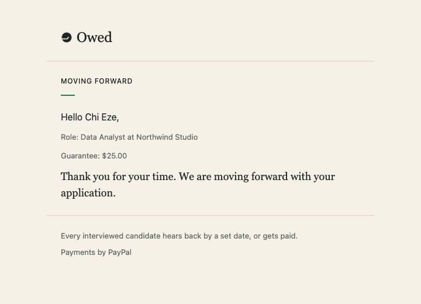
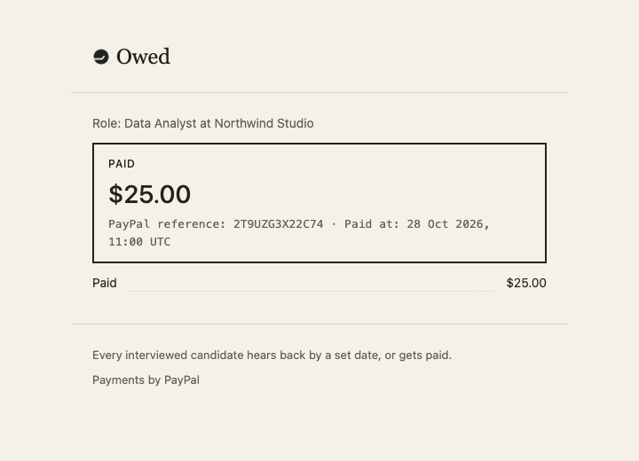

# Owed

Hear back by the date, or get paid.

Owed lets employers back their promise to reply after an interview. The employer sets an amount and a date, and PayPal holds the money. If a candidate hears nothing by that date, Owed pays them.

Live demo: [owed-vert-ten.vercel.app](https://owed-vert-ten.vercel.app). It runs on the PayPal sandbox, so all money is test money. Built for the PayPal AI Hackathon. Watch the [2:35 demo video](https://youtu.be/5Ymb56MXC1I).

## The promise, with numbers

An employer promises every candidate they interview an answer by a set date, and backs that promise with money held in PayPal.

| | |
| --- | --- |
| The employer promises | $25 per candidate, reply by a set date |
| PayPal holds | $75 for 3 candidates, nothing charged yet |
| Candidate hears back in time | Nothing is charged |
| Date passes with no answer | Owed pays that candidate $25 |
| Role closes | PayPal releases the rest |

AI helps the employer write the reply. It never decides who gets paid. Fixed rules on the server move the money.

Proven in the PayPal sandbox: on the live demo on 3 Nov 2026, an employer held $50.00 for two candidates. One candidate heard nothing by the date, and at 14:47 UTC Owed paid them $25.00 through PayPal without anyone pressing a button. Closing the role released the other $25.00. The [demo video](https://youtu.be/5Ymb56MXC1I) shows that run. [See the other sandbox runs](https://owed-vert-ten.vercel.app/docs/evidence/verified-examples) or [read the docs](https://owed-vert-ten.vercel.app/docs/get-started/introduction).

## The problem

Candidates prepare for an interview, take time off work, sit through the rounds, and then hear nothing. 63% of US job candidates say they were left in the dark after an interview ([Greenhouse 2025 Workforce & Hiring Report](https://www.prnewswire.com/news-releases/only-7-of-candidates-say-the-job-market-favors-them-amidst-challenges-of-ageism-ai-cheating-and-ghosting-302507370.html)). Most employers mean to reply, but nothing happens to them when they forget.

## What Owed does

Owed puts money behind the promise to reply. An employer picks an amount for each candidate they interview, for example $25, and a date by which every candidate will hear back. PayPal sets that money aside. If a candidate hears nothing by the date, Owed sends them their $25 through PayPal. If the employer replies on time, nobody pays anything and the money goes back.

## How it works

1. The employer opens a role and writes the promise as one sentence: "Pay each of 3 candidates for Product Designer $25 if they hear nothing by" a date up to three weeks away.
2. The employer approves one PayPal hold for the whole role, $75 in this example. The money is set aside in their PayPal account. It isn't charged.
3. The employer invites each interviewed candidate. The candidate signs in with PayPal and accepts. Only the person who was invited can accept.
4. Before the date, the employer sends each candidate an answer: moving forward, not moving forward, or still deciding with a new date. The employer can ask the AI to write the first draft.
5. A day before the date, Owed emails the employer about anyone still waiting.
6. If the date passes without an answer, Owed takes that candidate's $25 from the hold and pays it into their PayPal account. Nobody has to press a button.
7. When the role closes, PayPal releases whatever is left of the hold.

Here's what happens over the life of one role:

## What it looks like

These screenshots use test data.

### For employers

The role page reads like a receipt. It shows what's held, who has been invited, who has heard back, and who has been paid.

Writing an answer to a candidate. The AI drafts it, checks the wording, and warns the employer before anything risky goes out.

### For candidates

A candidate sees the employer's promise before they accept it.

If the date passes without an answer, the candidate sees the payment and its PayPal reference.

### Emails

Candidates get the employer's answer as a letter, and a receipt when they've been paid.

| The employer's answer | The payment receipt |
| --- | --- |
|  |  |

## PayPal integration

PayPal handles every step that involves money or identity. Owed runs on the PayPal sandbox only and refuses live PayPal unless it's switched on on purpose.

| What happens | PayPal feature |
| --- | --- |
| Employers and candidates sign in | Log in with PayPal, which returns a verified email and PayPal account ID |
| The employer sets the money aside | Orders v2 with intent `AUTHORIZE`, one hold per role |
| Keeping the hold alive for longer | Payments v2 reauthorize |
| A candidate wasn't answered in time | Payments v2 partial capture of that candidate's amount |
| The candidate gets paid | Payouts to the candidate's PayPal account ID |
| The role closes | Payments v2 void of what's left |
| Staying in sync | Reading orders, holds, captures and payouts back from PayPal. Webhooks are planned |

How Owed keeps money safe:

- Every PayPal request that moves money carries an ID built from what it's for, like "charge this candidate's guarantee". If Owed has to retry, PayPal sees the same ID and won't charge or pay twice.
- If PayPal doesn't answer in time, Owed doesn't guess whether the money moved. It asks PayPal again and goes by what PayPal says.
- A candidate is only ever paid into the PayPal account that accepted the invitation.

What we checked by hand in the PayPal sandbox:

- A hold lasts 29 days, and it can be renewed once, between day 4 and day 29.
- Two $25 charges came out of one $100 hold, and releasing it returned the other $50.
- A payout reached a candidate's verified PayPal account, sent by PayPal account ID.
- A payout to an email with no PayPal account stays unclaimed, and Owed shows it as unclaimed, never as paid.
- Log in with PayPal returned the candidate's name, email, PayPal account ID and verified status.
- Sending the same payout twice was refused the second time with "Batch with given sender_batch_id already exists", so a retry can't pay anyone twice. Owed then reads the original payout back.
- Taking only part of a hold leaves the rest available to release, while taking the full amount closes the hold.

Every PayPal call Owed makes, with its exact fields and the sandbox results, is written down in [`paypal-plan.md`](paypal-plan.md).

## What the AI does

The AI only works with words. It never decides whether money moves. Holds, payments and releases follow fixed rules.

- It drafts a short, kind answer that states the candidate's status and nothing more. The employer can edit it.
- It checks the final wording and flags anything that could hurt a candidate or cause trouble: reasons for a rejection, feedback, comparisons with other candidates, promises of future roles, or comments about age or other personal traits. The employer has to tick a box to confirm they've read a warning before sending.
- A "still deciding" answer must give the new date, and links or email addresses are refused.
- If the AI isn't available, the employer can still send Owed's standard answer, so a candidate is never left waiting because of it.

In one test, the message "We are not moving forward because we want someone younger with more energy. Maybe a future role will suit you." got three warnings: the reason, the age comment and the promise of a future role.

## Who pays the fees

Today the hold covers only the candidates' amounts, and Owed covers PayPal's fees, so candidates always get the full amount they were promised. In a sandbox test, PayPal charged a $0.52 fee on a $1.00 payment. Next, the employer's hold will include the expected fees too.

## Why an employer would use it

Owed costs an employer nothing if they do what they already promise. In return, they can show candidates that their promise to reply is backed by real money, which matters most where candidate experience affects who applies. Job boards could badge or rank those roles. These are arguments for the product. We haven't tested real employer demand yet.

## Tested with real PayPal sandbox accounts

Everything below ran on the live demo with PayPal sandbox accounts, and Owed's scheduler did every step on its own:

- An employer signed in with PayPal, approved a hold, and later closed the role, which released the hold.
- A candidate accepted an invitation in time, the date passed with no answer, and Owed paid them $1.00 through PayPal. The candidate's sandbox account received it, and both sides saw the PAID stamp with the PayPal reference.
- An employer held $50.00 for two candidates. The date passed with no answer for one candidate, Owed charged $25.00 from the hold and paid it to them, and closing the role released the other $25.00. This is the run in the demo video.
- AI wrote a closure letter and flagged feedback about a candidate's experience as a reason and a comparison. The employer sent a plain answer instead, it arrived as one email, and the $1.00 hold was released.
- A two-candidate role went through a reminder, a "still deciding" answer with a new date, and a final answer. Every email arrived exactly once, and the hold was released with nothing charged.

## Built with APIMatic

We built the PayPal integration with APIMatic's Context Plugin for PayPal. Every hold, charge, renewal and release goes through APIMatic's generated PayPal TypeScript SDK, `paypal`, installed from GitHub and pinned to one commit. Here's where the plugin shaped the work:

- Plan before code. The plugin's skills, copied into [`.devin/skills/`](.devin/skills/), required a contract sheet before any SDK code was written. [`paypal-plan.md`](paypal-plan.md) is that sheet. Every method, field and value in it came from the SDK's own map, not from memory.
- Sandbox by default. The SDK map showed that the SDK has only one environment and no way to pick another, so Owed sets the sandbox address itself and refuses live PayPal unless it's turned on deliberately.
- Knowing the gaps. The map also showed what the SDK doesn't cover: Payouts, Log in with PayPal and webhooks. Those go to PayPal's REST API directly.
- Handling failures. The error-handling skill shaped Owed's single place for PayPal errors. A dropped connection while moving money counts as "unknown" and gets checked with PayPal, never treated as a failure.
- Finding bugs early. The testing skill's approach tests the exact requests the SDK sends. It caught the SDK rejecting PayPal's empty reply when a hold was released, which Owed now handles by reading the hold back.
- Sandbox findings. Leaving out the body when authorizing or renewing a hold made the SDK drop a header, and PayPal refused the request. Owed sends an empty body, and the fix is recorded in the plan.
- No leaks. Reading the pinned SDK version turned up a built-in logging option, which Owed switches off so no PayPal details end up in logs.

## What's next

- Employers cover PayPal's fees as part of the hold.
- PayPal webhooks, so Owed hears about changes right away.
- A charity fallback for payments a candidate never collects.
- A review for live PayPal.

## For developers

Setup, architecture, the database, the scheduler and every PayPal detail are in the [technical notes](docs/technical.md).

## License

MIT. The APIMatic skills in `.devin/skills/` are MIT licensed by APIMatic.
