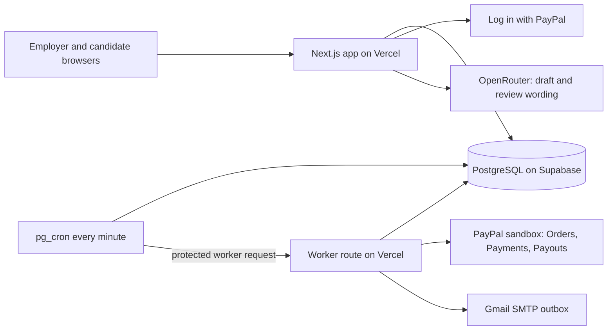

# Owed: technical notes

This page is for developers. For what Owed is and how it works, start with the [README](../README.md).

## Architecture



The database marks deadlines on its own every minute. The worker then claims one PayPal operation at a time with a lease and a fencing token, so overlapping runs are safe and a crashed run is picked up again. Every PayPal write carries a request ID derived from a stable business key, so a retry can never charge or pay twice.

## Status and evidence

Built for the PayPal AI Hackathon and deployed at https://owed-vert-ten.vercel.app. It runs against the PayPal sandbox only. 

What exists today:

- The PayPal layer in `src/lib/paypal/`: role holds, partial charges, releases and renewals through APIMatic's generated PayPal SDK, plus Payouts, Log in with PayPal and webhook verification over PayPal REST
- One error-translation boundary for every PayPal failure
- The contract sheet for every PayPal call in `paypal-plan.md`
- A private PostgreSQL schema for Supabase, including roles, PayPal identities, guarantees, operation claims, hashed sessions and an in-app notification inbox
- A recoverable worker with per-role sequencing, leased claims, fencing tokens and fixed deadline rules
- Plain employer screens for funding roles, sharing invitations, sending status-only closure, and releasing unused holds
- Plain candidate screens for PayPal connection, guarantee/payout status and review flags

The sandbox checks are listed in the [README](../README.md#paypal-integration), and `paypal-plan.md` records the exact results.

The schema and worker are tested against local PostgreSQL 17. On 2026-10-19, the owner approved pausing Setlo to free a Supabase slot. Owed now has its own healthy project, [`kjpbyrvnygiptznftyuk`](https://supabase.com/dashboard/project/kjpbyrvnygiptznftyuk), in `eu-west-1`. The schema and database-only minute deadline job are applied. All seven tables have RLS enabled, the unique operation constraint exists, and neither `anon` nor `authenticated` has access to the private schema. The application-to-session-pooler connection was verified with certificate validation enabled. The HTTP worker runs every minute against the deployed app. The employer and candidate flows, including capture, payout, closure emails and release, were tested end to end on the deployed site with real sandbox accounts.

Not built yet: employer fee recovery, charity fallback for returned payouts, and webhook ingestion. The existing webhook signature-verification helper is not a registered webhook endpoint. Current recovery polls PayPal instead. Employers can send Owed's standard status message, or have the AI draft one. `src/lib/owed/closure-ai.ts` asks OpenRouter (`OPENROUTER_MODEL`, default `nvidia/nemotron-3.5-super-vl:free`) for a status-only draft, then a second call reviews it and flags reasons, feedback, comparisons, promises, personal characteristics or a status mismatch. The employer can edit the draft, and every edited message is reviewed again. Flagged wording needs an explicit acknowledgment. A missing new date on a still-deciding message, or a link or email address, blocks sending. If the model is unavailable, only the standard message can be sent. The AI never moves money. The review is stored in `guarantees.closure_review`. This sandbox charges the guarantee principal and funds PayPal fees from the merchant balance, so candidates receive the full promised amount.

## PayPal and APIMatic

The PayPal integration, the sandbox results and how APIMatic's Context Plugin shaped them are in the [README](../README.md#paypal-integration). Every call's exact contract is in [`paypal-plan.md`](../paypal-plan.md).

## Running it

Requires Node.js 24. Tests use Node's module hooks and a dedicated PostgreSQL 17 test database.

```bash
npm install
cp .env.example .env.local
npm run dev
```

Fill in `PAYPAL_CLIENT_ID` and `PAYPAL_CLIENT_SECRET` from the sandbox app. Enable Log in with PayPal, including the email, PayPal account ID and verified account attributes. Register `${APP_URL}/auth/paypal/callback` as its return URL. Both employers and candidates use PayPal login, with opaque HttpOnly SameSite sessions. No OAuth access or refresh tokens are stored. Employers must enter the candidate's PayPal email when creating an invitation. Only a matching PayPal login with both `email_verified` and `verified_account` can view or accept it. Payouts remain bound to the candidate's payer ID. If PayPal omits email verification, the invitation fails closed until the account can return a verified email.

If the employer mistyped the PayPal email, they can correct an unclaimed invitation before its deadline. This replaces the private link while preserving the same guarantee, deadline, and funded place. The old link immediately stops working. After acceptance or the deadline, the employer cannot redirect it. An overdue guarantee with an unreachable recipient requires operator review; it cannot be reassigned after the fact.

### Database and scheduler

1. Use Owed's dedicated Supabase project, not another application's database. Its initial schema, invitation identity migration and database deadline job are already applied. The following migration instructions are only for rebuilding a new environment.
2. Set the server-only `DATABASE_URL` from the repo-scoped Owed secret to the project's Supavisor session-mode or direct connection string, with `sslmode=verify-full`. The verified session endpoint is `aws-0-eu-west-1.pooler.supabase.com:5432`, with username `owed_app.kjpbyrvnygiptznftyuk`. `owed_app` is a dedicated login role with `BYPASSRLS` and data access to the `owed` schema only, because Supabase refuses to reset the `postgres` password through SQL. Set `NODE_EXTRA_CA_CERTS` to the absolute deployed path of `supabase/certs/prod-ca-2021.crt`, which is `/var/task/supabase/certs/prod-ca-2021.crt` on Vercel. `next.config.ts` bundles the file into every function, downloaded from [Supabase's official certificate URL](https://supabase-downloads.s3-ap-southeast-1.amazonaws.com/prod/ssl/prod-ca-2021.crt). Never print the connection string or disable certificate verification. The `owed` schema is private, is not exposed through PostgREST, and has RLS enabled with no public policies. Backend connections must use the schema owner or an explicitly provisioned privileged database role.
3. For a fresh environment only, apply `supabase/migrations/202610190001_owed.sql`, then `supabase/migrations/202610190002_invitation_identity.sql`, then `supabase/migrations/202610200001_email_outbox.sql`, then `supabase/migrations/202610200002_closure_drafts.sql`, with the Supabase SQL editor or PostgreSQL migration tooling. Both are already applied to the existing Owed project, so do not reapply them there. The second migration keeps earlier unclaimed invitations with no intended email unclaimable until an employer issues a corrected link before the deadline, or an operator reviews them afterward. Apply `supabase/deadlines.sql` to enable the database-only deadline tick independently of app hosting. Re-running the deadline script updates the named job instead of adding duplicates.
4. Deploy the app with `APP_URL` set to its HTTPS origin. The sandbox deployment is the Vercel project `owed` at `https://owed-vert-ten.vercel.app`, deployed from `main`. Set a random `CRON_SECRET` of at least 32 characters. Keep database and PayPal credentials server-only.
5. In Supabase Vault, add `owed_app_url` with that origin and `owed_cron_secret` with the same worker secret. Apply `supabase/schedule.sql`. This enables `pg_cron` and `pg_net`, then schedules `owed.tick()` and a protected worker request every minute. The script deliberately fails if the Vault values are missing. Neither secret is placed in cron SQL.
6. Check `cron.job_run_details`, `net._http_response`, and `owed.paypal_operations` after deployment. The database job only marks deadlines and writes in-app nudges. It cannot capture or pay money without the HTTP worker. A successful cron SQL job alone does not prove the HTTP worker succeeded. Unclaimed payouts stay unclaimed and continue polling, never appearing paid. Rejected/manual-review operations need operator investigation of the original PayPal reference, not a replacement business key.

The HTTP worker processes one operation per invocation to fit a 60-second request budget. Overlapping invocations are safe. Larger workloads need more frequent worker dispatch or a longer-lived worker, not a larger unbounded batch inside a request. Nudge notifications appear in the employer dashboard 24 hours before the deadline. Every notification is also emailed. Each worker request drains up to five from the `owed.notifications` outbox over Gmail SMTP, using the server-only `GMAIL_USER` and `GMAIL_APP_PASSWORD`. Candidates get their closure status and a paid notice, and employers get the deadline nudge. Unless `EMAIL_DELIVER_TO_RECIPIENTS=true`, every email goes to `EMAIL_SANDBOX_RECIPIENT`, or to `GMAIL_USER` when that is unset, with the intended recipient named in the body, because sandbox PayPal emails are not real inboxes. Direct delivery only goes to an address PayPal reports as verified. If Gmail can't be reached, nothing is claimed and emails wait. An explicit SMTP rejection retries up to three attempts, five and then ten minutes apart. A dropped connection, a timeout or an interrupted send becomes `unknown` and is never resent, so nobody gets the same email twice. Without Gmail credentials, emails wait as `pending`. The deadline update itself runs in PostgreSQL even if HTTP dispatch fails, then durable operations catch up when the worker returns. An invited candidate's overdue guarantee is captured even before they connect; payout waits for their verified account.

Deadlines are UTC, within 21 days, and at least a day before the authorization expires. One extension is allowed. Renewal is queued after four days if candidates are still pending, and never repeated after a successful renewal. A late closure cannot cancel an owed guarantee. Each invitation consumes one funded place, even after closure. There is no reuse of a closed slot for an extra interview.

### Checks

```bash
npm run lint
npm run typecheck
npm test
createdb owed_test
DATABASE_URL=postgresql://localhost/owed_test npm run test:db
npm run build
```

Database tests rebuild only the `owed` schema in a localhost database named exactly `owed_test` and refuse other targets. They use a fake money provider, not PayPal credentials. SDK tests stub only `fetch`, keep retries off and use wire-shaped responses. CI runs the same checks with a disposable PostgreSQL 17 service. Hosted validation checks schema/permissions, calls `owed.tick()` and inspects real `pg_cron` runs. The `pg_net` HTTP schedule is enabled on the hosted project.

## License

MIT. The APIMatic skills in `.devin/skills/` are MIT licensed by APIMatic.
